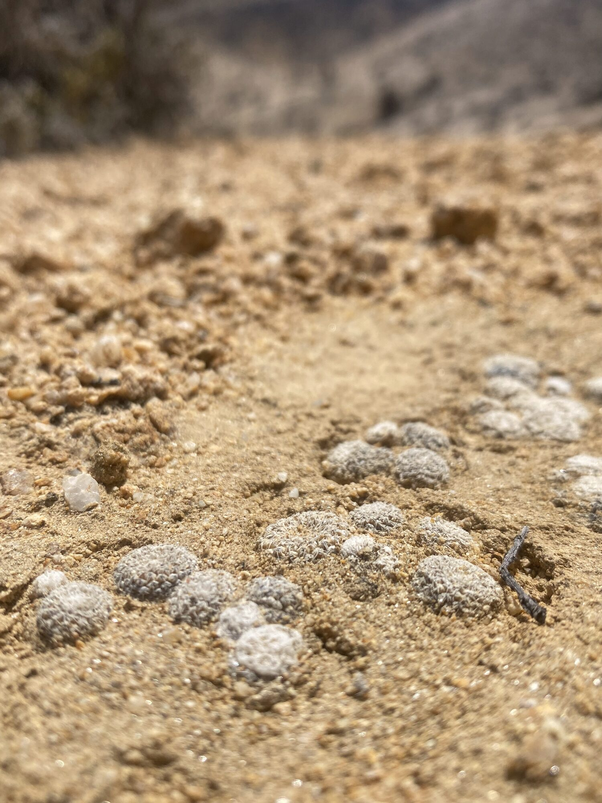
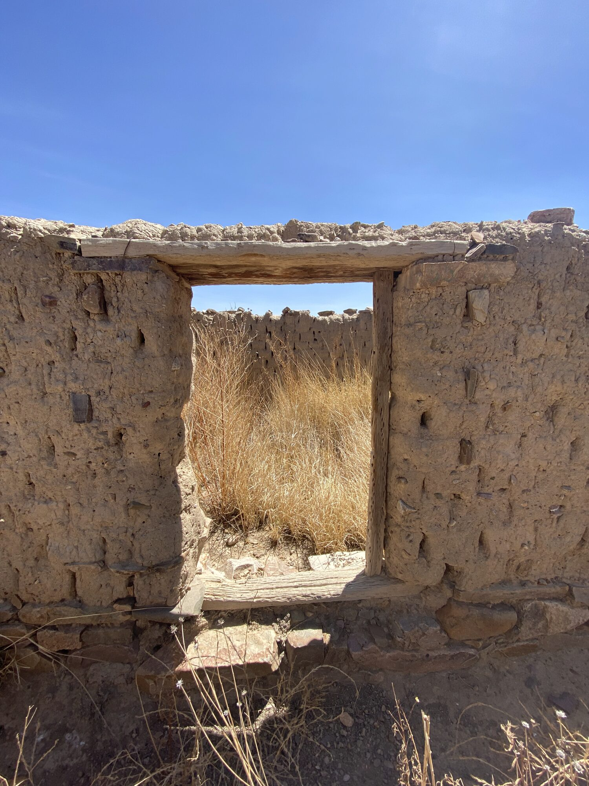
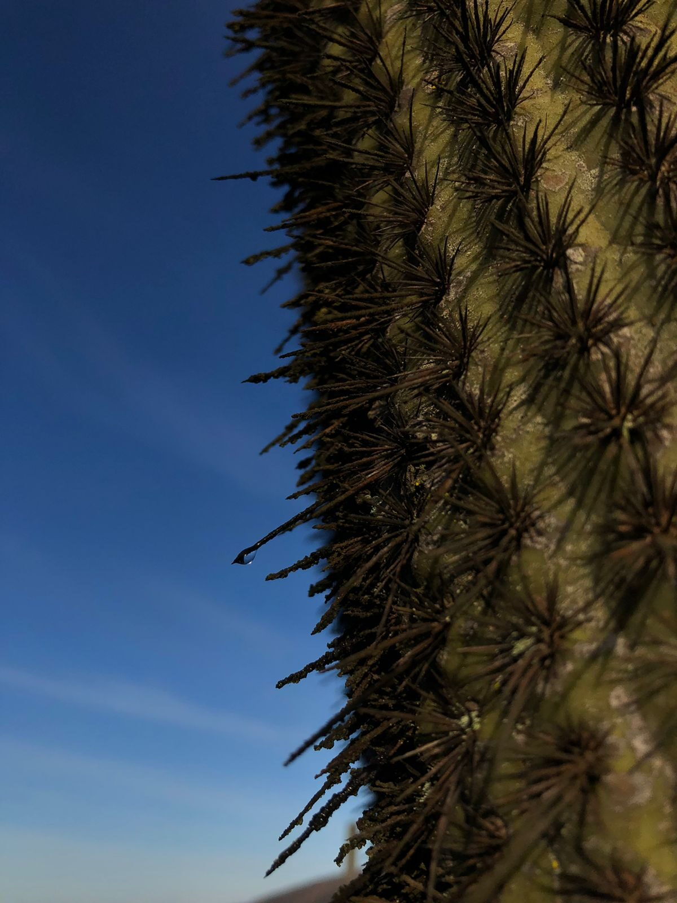
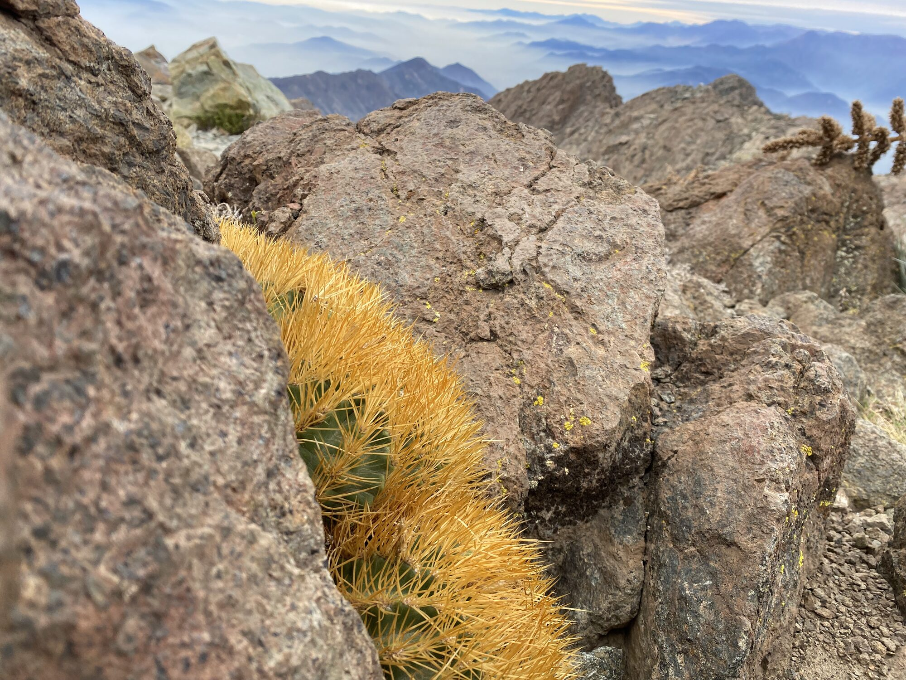
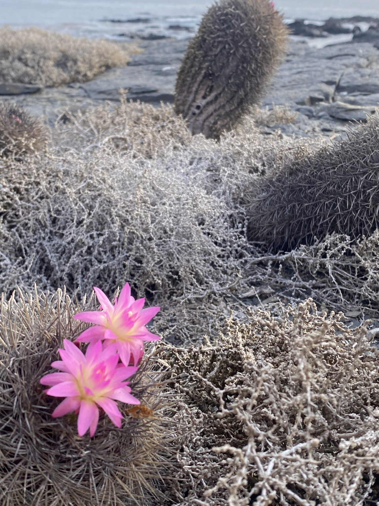
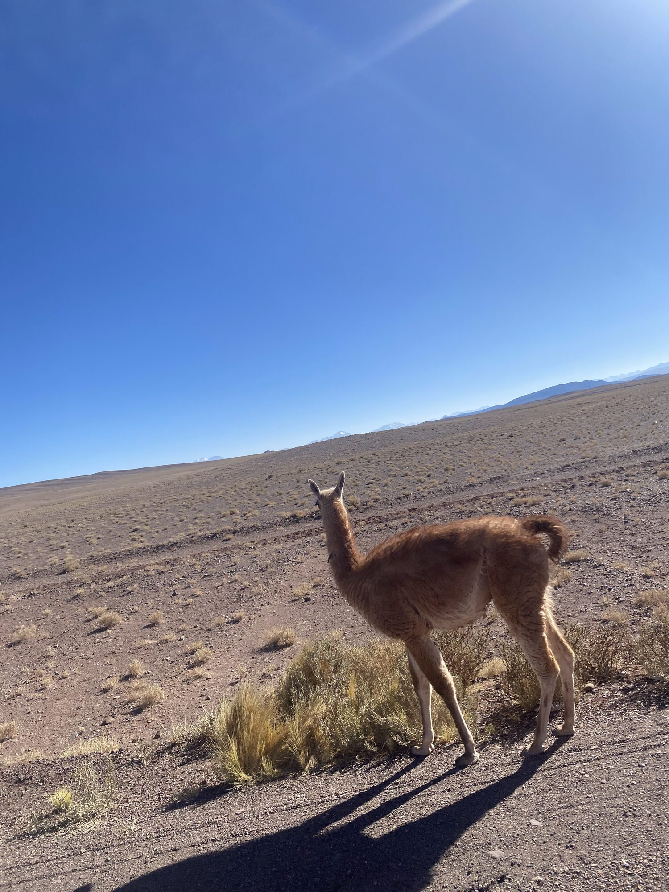
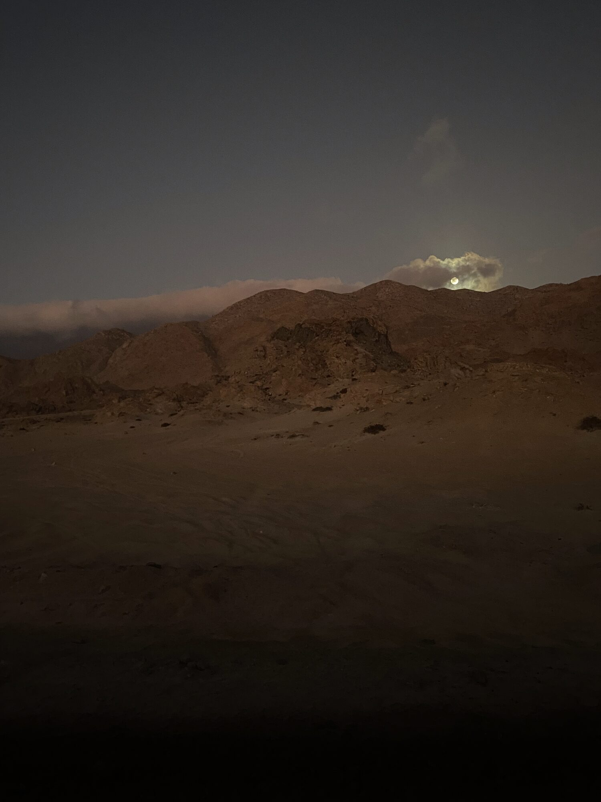
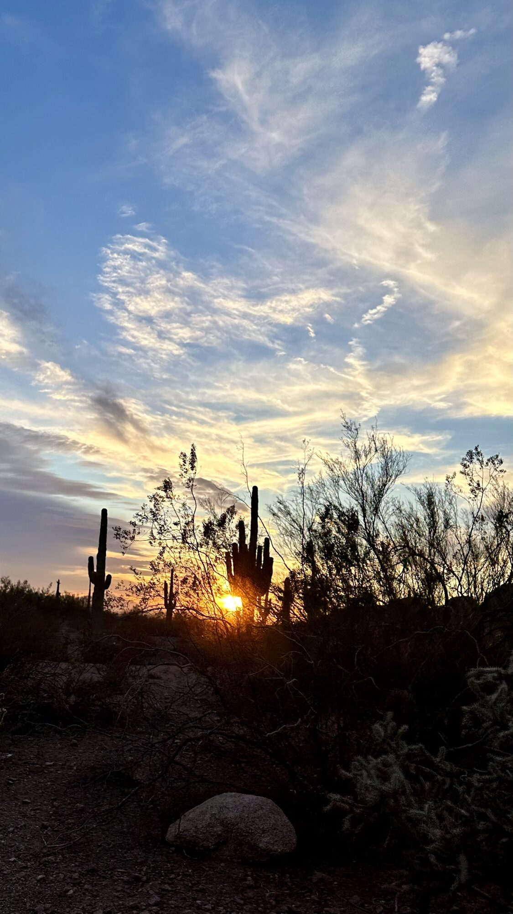
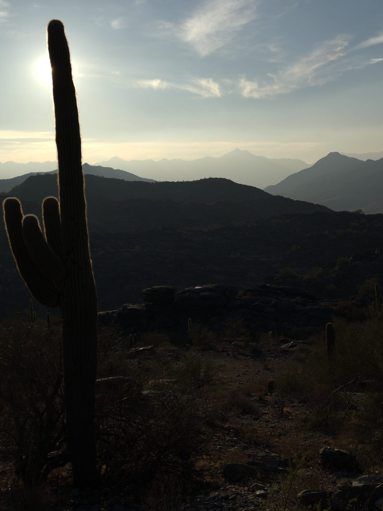
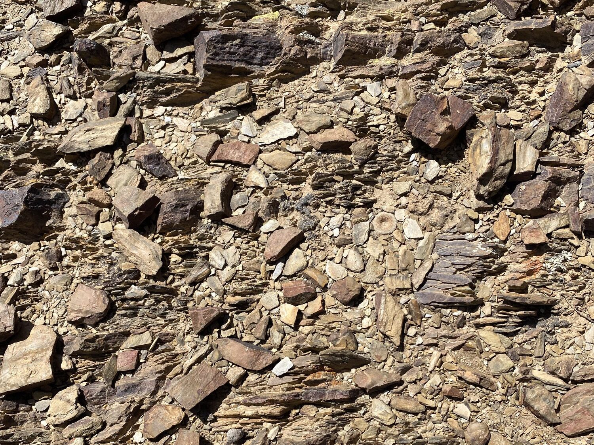

<!-- AUTO-GENERATED by scripts/build_gallery.py from data/gallery.csv. Do not edit. -->

```{=html}
<div class="gallery-grid">
<figure class="g-item"><a href="assets/gallery/copiapoa-humilis.jpg" class="lightbox" data-gallery="galeria" data-description="Copiapoa humilis: plantas diminutas que apenas asoman entre la arena y la grava."></a>
<figcaption><em>Copiapoa humilis</em>: plantas diminutas que apenas asoman entre la arena y la grava.<span class="g-meta">Desierto de Atacama</span></figcaption>
</figure>
<figure class="g-item"><a href="assets/gallery/casa-de-piedra.jpg" class="lightbox" data-gallery="galeria" data-description="Una casa de piedra abandonada; la puerta, con marco de madera probablemente de Leucostele atacamensis, deja ver el pajonal."></a>
<figcaption>Una casa de piedra abandonada; la puerta, con marco de madera probablemente de <em>Leucostele atacamensis</em>, deja ver el pajonal.<span class="g-meta">Cerca de Salta, Argentina</span></figcaption>
</figure>
<figure class="g-item"><a href="assets/gallery/leucostele-chiloensis-espinas.jpg" class="lightbox" data-gallery="galeria" data-description="Espinas de Leucostele chiloensis a contraluz, donde se condensa la humedad de la camanchaca."></a>
<figcaption>Espinas de <em>Leucostele chiloensis</em> a contraluz, donde se condensa la humedad de la <a href="https://es.wikipedia.org/wiki/Camanchaca" target="_blank" rel="noopener">camanchaca</a>.<span class="g-meta">Chile central</span></figcaption>
</figure>
<figure class="g-item"><a href="assets/gallery/eriosyce-garaventae.jpg" class="lightbox" data-gallery="galeria" data-description="Eriosyce garaventae en la cordillera de la Costa, con un mar de nubes y la cordillera de los Andes al fondo."></a>
<figcaption><em>Eriosyce garaventae</em> en la cordillera de la Costa, con un mar de nubes y la cordillera de los Andes al fondo.<span class="g-meta">Chile central</span></figcaption>
</figure>
<figure class="g-item"><a href="assets/gallery/eriosyce-litoralis.jpg" class="lightbox" data-gallery="galeria" data-description="Eriosyce litoralis en flor, en medio del matorral costero."></a>
<figcaption><em>Eriosyce litoralis</em> en flor, en medio del matorral costero.<span class="g-meta">Región de Coquimbo</span></figcaption>
</figure>
<figure class="g-item"><a href="assets/gallery/guanaco.jpg" class="lightbox" data-gallery="galeria" data-description="Un guanaco en la pampa del desierto."></a>
<figcaption>Un guanaco en la pampa del desierto.<span class="g-meta">Desierto de Atacama</span></figcaption>
</figure>
<figure class="g-item"><a href="assets/gallery/luna-desierto.jpg" class="lightbox" data-gallery="galeria" data-description="La luna asoma sobre los cerros de la costa del desierto."></a>
<figcaption>La luna asoma sobre los cerros de la costa del desierto.<span class="g-meta">Desierto de Atacama</span></figcaption>
</figure>
<figure class="g-item"><a href="assets/gallery/saguaro-atardecer.jpg" class="lightbox" data-gallery="galeria" data-description="Saguaros (Carnegiea gigantea) en mi camino al Desert Botanical Garden."></a>
<figcaption>Saguaros (<em>Carnegiea gigantea</em>) en mi camino al Desert Botanical Garden.<span class="g-meta">Arizona, EE. UU.</span></figcaption>
</figure>
<figure class="g-item"><a href="assets/gallery/saguaro-contraluz.jpg" class="lightbox" data-gallery="galeria" data-description="Un saguaro a contraluz en los cordones de South Mountain, Phoenix."></a>
<figcaption>Un saguaro a contraluz en los cordones de <a href="https://www.google.com/maps/search/?api=1&amp;query=South+Mountain+Park+and+Preserve%2C+Phoenix%2C+AZ" target="_blank" rel="noopener">South Mountain</a>, Phoenix.<span class="g-meta">Arizona, EE. UU.</span></figcaption>
</figure>
<figure class="g-item g-game">
<div class="g-frame">
<span class="g-answer" hidden style="left:64.8%;top:50.0%;width:9.4%;"></span></div>
<button type="button" class="btn btn-sm btn-outline-secondary g-reveal" data-show="Ver respuesta" data-hide="Ocultar respuesta">Ver respuesta</button>
<figcaption>¿Lo encuentras? En esta ladera de lajas hay una <em>Yavia cryptocarpa</em>.<span class="g-meta">Puna argentina</span></figcaption>
</figure>
</div>
<script>
document.querySelectorAll(".g-reveal").forEach(function (b) {
  b.addEventListener("click", function () {
    var a = b.parentElement.querySelector(".g-answer"); a.hidden = !a.hidden;
    b.textContent = a.hidden ? b.dataset.show : b.dataset.hide; });
});
</script>
```
