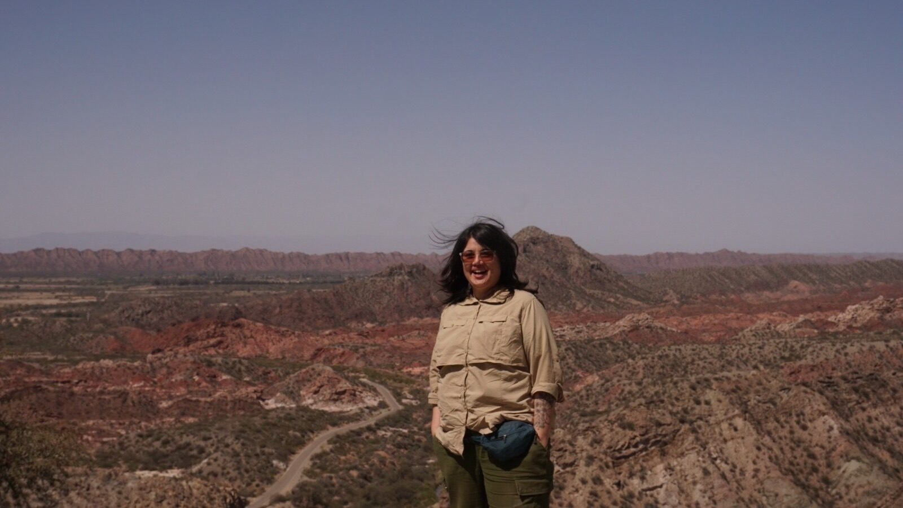

```{=html}
<figure class="hero-banner"></figure>
<div class="hero">
  <div class="hero-text">
    <p class="hero-name" role="heading" aria-level="1">Beatriz M. Meriño</p>
    <p class="hero-tagline">Biologist · M.Sc. in Botany · Ph.D. Candidate in Systematics and Biodiversity</p>
```

I study how plants diversify in the arid ecosystems of the Americas and why some regions hold far more species than others, with cacti as my main study system. To answer this I build dated phylogenies from public data and develop reproducible R tools that turn GenBank and biodiversity records into curated sequence matrices. I combine phylogenetics, historical biogeography, species distribution modeling and GIS. Since 2017 I have also worked in environmental assessment, ecological restoration and university teaching in Chile.

::: btn-row
[<i class="bi bi-download"></i> CV (English)](../assets/cv/CV_Beatriz_Merino_EN.pdf){.btn .btn-primary} [<i class="bi bi-download"></i> CV (español)](../assets/cv/CV_Beatriz_Merino_ES.pdf){.btn .btn-primary} [<i class="bi bi-github"></i> GitHub](https://github.com/beeamerino){.btn .btn-outline-primary} [ORCID](https://orcid.org/0000-0002-9518-2331){.btn .btn-outline-primary} [<i class="bi bi-mortarboard"></i> Google Scholar](https://scholar.google.cl/citations?user=RLAXrAcAAAAJ){.btn .btn-outline-primary} [<i class="bi bi-envelope"></i> Email](mailto:beeatriz.merino@gmail.com){.btn .btn-outline-primary}
:::

```{=html}
    <p class="hero-location"><i class="bi bi-geo-alt"></i> Concepción, Chile · open to remote, hybrid and international roles</p>
  </div>
  <div class="hero-side">
<pre class="ascii" id="hero-ascii" aria-hidden="true" hidden>
          .--.
          |  |
    .--.  |  |
    |  |  |  |  .--.
    |  |  |  |  |  |
    |  '--'  |  |  |
    '-----.  '--'  |
          |  .-----'
          |  |
          |  |
   ~~~~~~~|  |~~~~~~~
</pre>
  </div>
</div>
```

## What I do

::: tags
[Macroevolution and biogeography]{.tag} [Phylogenetics and molecular dating]{.tag} [Curation of public data (GenBank, GBIF, Darwin Core)]{.tag} [Taxonomic reconciliation]{.tag} [DNA barcoding]{.tag} [Population genetics and genomics]{.tag} [Species distribution modeling]{.tag} [GIS and remote sensing]{.tag} [R development (libraries, Shiny, Quarto)]{.tag} [Environmental assessment and restoration]{.tag} [Teaching and science communication]{.tag}
:::

## Featured work

:::::: card-grid
::: pcard
[Software]{.kicker}

#### PhyloCactus

R library for reproducible multilocus phylogenetics from GenBank: sequence mining, taxonomic curation, dated trees and DNA barcoding.

[Code](https://github.com/beeamerino/PhyloCactus) · [Documentation](https://beeamerino.github.io/PhyloCactus/)
:::

::: pcard
[Paper · Annals of Botany 2024]{.kicker}

#### Pleistocene climate and speciation

How glacial–interglacial cycles shaped range expansion and contraction, and with them speciation, in *Eriosyce* sect. *Neoporteria* in central Chile.

[Read the paper](https://doi.org/10.1093/aob/mcae087)
:::

::: pcard
[Doctoral thesis · in progress]{.kicker}

#### Biogeography and species richness

Why some regions of the Americas hold more species: colonization age, dispersal and diversification reconstructed on a dated phylogeny.

[More research →](research.qmd)
:::
::::::

::: {.divider aria-hidden="true"}
· · ·
:::

## Education

::: timeline-item
### Ph.D. Candidate in Systematics and Biodiversity

Universidad de Concepción, Chile · [in progress]{.when}

Thesis: *¿Qué factores estructuran la heterogeneidad de riqueza de cactáceas en los biomas de América?* [What factors structure the heterogeneity of cactus richness across the biomes of the Americas?]. Research internship at the Desert Botanical Garden and Arizona State University (Phoenix, USA, 2024).
:::

::: timeline-item
### Master of Science in Botany

Universidad de Concepción, Chile · [2021]{.when}

Thesis: *Oscilaciones climáticas y el conservatismo de nicho climático promueven la especiación alopátrica en cactus globosos polinizados por picaflores* [Climatic oscillations and climatic niche conservatism promote allopatric speciation in hummingbird-pollinated globose cacti] (grade 7.0 on a 1–7 scale, Sobresaliente). [Read the thesis (in Spanish)](https://repositorio.udec.cl/items/ba752332-f741-4092-bef8-04610ea96fcd)
:::

::: timeline-item
### Biologist (professional degree) and Bachelor of Science in Biology

Universidad de Concepción, Chile · [2017]{.when}

Undergraduate thesis on the conservation genetics of the Chilean lúcumo (*Pouteria splendens*).
:::
