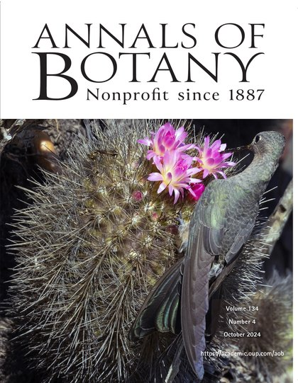

[Estudio cómo se diversifican y persisten los linajes de plantas en los ecosistemas áridos y mediterráneos, y cómo ese conocimiento puede orientar su conservación.]{.lead-text}

## Tesis doctoral (en curso)

*Doctorado en Sistemática y Biodiversidad · Universidad de Concepción · Profesor guía: Dr. Pablo C. Guerrero*

«¿Qué factores estructuran la heterogeneidad de riqueza de cactáceas en los biomas de América?» La tesis combina una filogenia datada de la familia con reconstrucciones biogeográficas para entender por qué algunas regiones concentran muchas más especies que otras. Tiene dos líneas de trabajo, ambas en desarrollo:

### 1. PhyloCactus: de GenBank a filogenias datadas

{.section-logo fig-alt="Logo de PhyloCactus"}

Librería de R que automatiza el minado de secuencias de GenBank, el curado taxonómico con la lista de especies de Caryophyllales.org, la construcción de supermatrices multilocus y de bibliotecas de referencia de secuencias para identificación molecular (DNA Barcoding), y la inferencia y datación de filogenias de Cactaceae. Es la base filogenética de toda la tesis.

La librería funciona y está documentada; el manuscrito está en preparación.\
[Código](https://github.com/beeamerino/PhyloCactus) · [Documentación](https://beeamerino.github.io/PhyloCactus/)

### 2. Biogeografía histórica y riqueza regional de cactáceas

Reconstruye la historia biogeográfica de la familia con BioGeoBEARS y mapeo estocástico biogeográfico para estimar, por región, la edad de colonización, las tasas de dispersión y la diversificación. Luego evalúa cuánto explica cada componente de la riqueza regional en tres formas de dividir el espacio climático (biomas, Köppen-Geiger y clústeres climáticos multivariados), con modelos mixtos (GLMM) y validación con aprendizaje autónomo (ML).

El código funciona y hay resultados preliminares; el análisis final depende de la filogenia datada de PhyloCactus.

## Tesis de magíster

```{=html}
<figure class="cover-fig"><a href="https://academic.oup.com/aob/issue/134/4" target="_blank" rel="noopener"></a><figcaption>Portada de <em>Annals of Botany</em> 134(4), 2024. Foto: <a href="https://www.instagram.com/bernardosegurafoto/" target="_blank" rel="noopener">Bernardo Segura</a>.</figcaption></figure>
```

*Magíster en Ciencias mención Botánica · Universidad de Concepción · nota 7,0 en escala de 1 a 7 (2021)*

«Oscilaciones climáticas y el conservatismo de nicho climático promueven la especiación alopátrica en cactus globosos polinizados por picaflores». La tesis estudia cómo las oscilaciones climáticas del Pleistoceno generaron ciclos de expansión y contracción de rango, y con ellos especiación, en *Eriosyce* secc. *Neoporteria*. El mismo linaje permite evaluar cómo se revela la diversidad críptica y cómo se delimitan especies con datos moleculares.

Usé filogenética, filogeografía, modelamiento de distribución de especies en climas pasados y delimitación de especies.

Productos: [tesis completa (Repositorio UdeC)](https://repositorio.udec.cl/items/ba752332-f741-4092-bef8-04610ea96fcd) · [Meriño *et al.* 2024, *Annals of Botany*](https://doi.org/10.1093/aob/mcae087), artículo de portada del [número 134(4)](https://academic.oup.com/aob/issue/134/4)

## Tesis de pregrado: el lúcumo chileno (*Pouteria splendens*)

*Título profesional de Bióloga y grado de Licenciada en Biología · Universidad de Concepción (2017)*

Estudié la genética de la conservación de un arbusto endémico de la costa de Chile central, en peligro de extinción, y del cual quedan sólo dos poblaciones naturales. Los afloramientos rocosos son refugios que conservan su diversidad genética y permiten su regeneración.

Productos: [Carvallo *et al.* 2019, *Biodiversity and Conservation*](https://doi.org/10.1007/s10531-019-01797-6) · presentación oral en el XII Congreso Latinoamericano de Botánica (Quito, 2018) · columna de divulgación en *El Mercurio* (2022).
