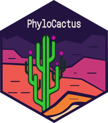

[Escribo código documentado y probado para analizar datos de biodiversidad, principalmente en R.]{.lead-text}

:::::: card-grid
::: pcard
[Librería de R]{.kicker}

#### PhyloCactus

{.card-logo fig-alt="Logo de PhyloCactus"}

Un flujo de trabajo de 13 módulos para la filogenética de Cactaceae: minado de GenBank, alineamiento, evaluación de saturación, selección de modelos, inferencia de máxima verosimilitud con restricciones en RAxML-NG, datación con treePL, integración con la Lista Roja de la UICN y validación frente a árboles publicados. Incluye un módulo de código de barras de ADN para identificar muestras de cactus.

[GitHub](https://github.com/beeamerino/PhyloCactus) · [Documentación](https://beeamerino.github.io/PhyloCactus/)
:::

::: pcard
[Tutorial · en español]{.kicker}

#### MappingR: visualización de datos espaciales en R

Tutorial paso a paso (BIODATA, 2024) para hacer mapas de calidad de publicación: límites administrativos, datos de clima, suelo y elevación, relieve sombreado, paletas hipsométricas, barras de escala y mapas de ubicación con sf, terra, ggplot2 y tidyterra.

[Tutorial](https://beeamerino.github.io/BIODATA-MappingR/MappingR.html) · [GitHub](https://github.com/beeamerino/BIODATA-MappingR)
:::

::: pcard
[App Shiny · en desarrollo]{.kicker}

#### Climatic Stability

Evalúa la idoneidad climática de predios agrícolas (por ejemplo, viñedos) en climas pasados (Último Interglacial, UMG, Holoceno medio), presentes y futuros (CMIP6). Está construida con terra, biomod2, capas climáticas CHELSA/PaleoClim, mapas Leaflet y un informe automático en Quarto.

*Código aún no publicado.*
:::
::::::

## Habilidades técnicas

::: software-table
| Área | Qué hago | Herramientas |
|------------------------|------------------------|------------------------|
| Inferencia filogenética | Máxima verosimilitud e inferencia bayesiana, selección de modelos y particiones, soporte de nodos (bootstrap, TBE), árboles de especies por coalescencia | RAxML-NG, IQ-TREE, MrBayes, ModelTest-NG, PartitionFinder, ASTRAL-III |
| Datación molecular | Tiempos de divergencia con calibraciones e incertidumbre temporal | treePL |
| Comparación de filogenias | Congruencia entre topologías y espacio de árboles (Robinson-Foulds, distancias de información) | TreeDist, phangorn, ape |
| Macroevolución | Tasas y regímenes de diversificación | BAMM, MiSSE (hisse), DR, diversitree, phytools |
| Biogeografía histórica | Reconstrucción de rangos ancestrales y mapeo estocástico biogeográfico | BioGeoBEARS (BSM) |
| Genética de poblaciones | Estructura, ancestría y diversidad genética | SNP por RAD-seq, microsatélites, STRUCTURE, DAPC |
| Secuencias y curación | Minado de GenBank, alineamiento, enmascarado y control de calidad | phylotaR, rentrez, MAFFT, DECIPHER, trimAl, Biostrings |
| Estadística y aprendizaje automático | Modelos lineales mixtos, selección de modelos (AIC), validación cruzada, análisis multivariado y agrupamiento (clustering) | glmmTMB, tidymodels, ranger, xgboost, FactoMineR, cluster |
| Análisis espacial y modelos de distribución (SDM) | Modelamiento de distribución de especies en climas pasados, presentes y futuros; teledetección | biomod2, terra, sf, CHELSA, PaleoClim, QGIS, Landsat, fotogrametría con dron, NDVI |
| Datos de biodiversidad | Registros de presencia, estándares y conciliación taxonómica | GBIF (rgbif), Darwin Core, taxize, Caryophyllales.org, API de la Lista Roja de la UICN |
| Programación y reproducibilidad | Desarrollo de librerías, visualización, aplicaciones web y flujos automatizados | R (tidyverse, ggplot2, ggtree), devtools, testthat, pkgdown, Shiny, Quarto, Git, GitHub Actions, Python, computación de alto rendimiento (NLHPC) |
| Laboratorio | Biología molecular y ecofisiología | Extracción de ADN en tejidos recalcitrantes, PCR, preparación para secuenciación, citometría de flujo, isótopos estables |
:::
